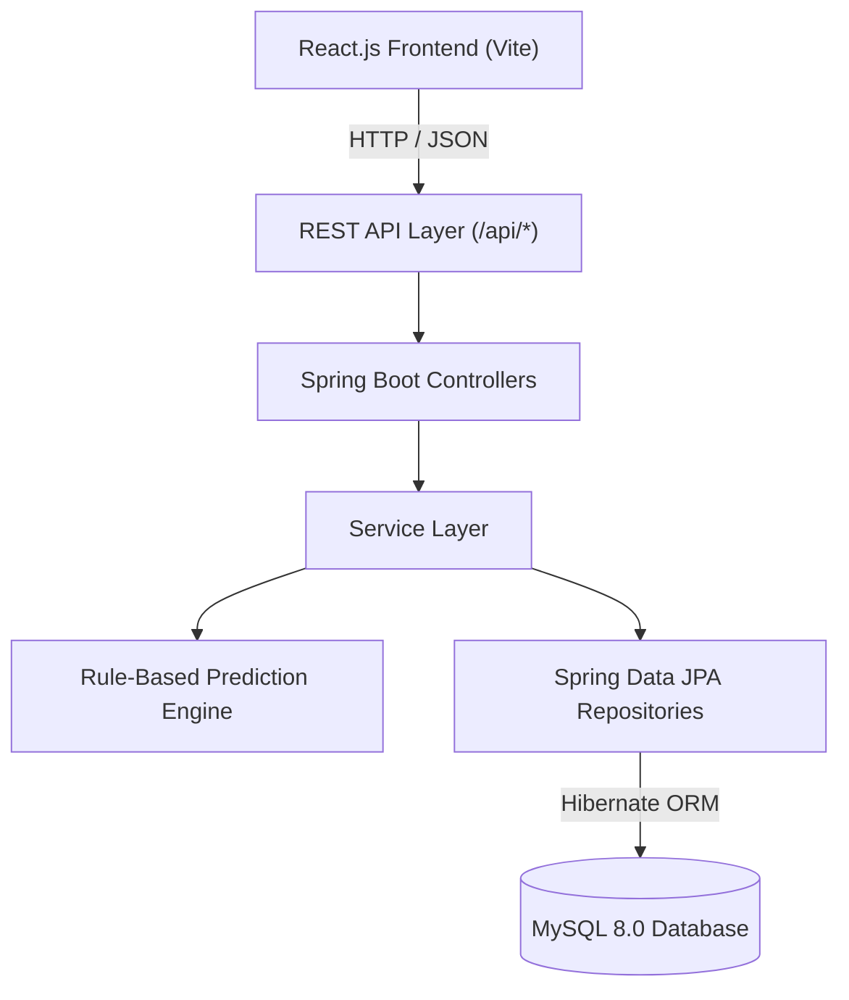
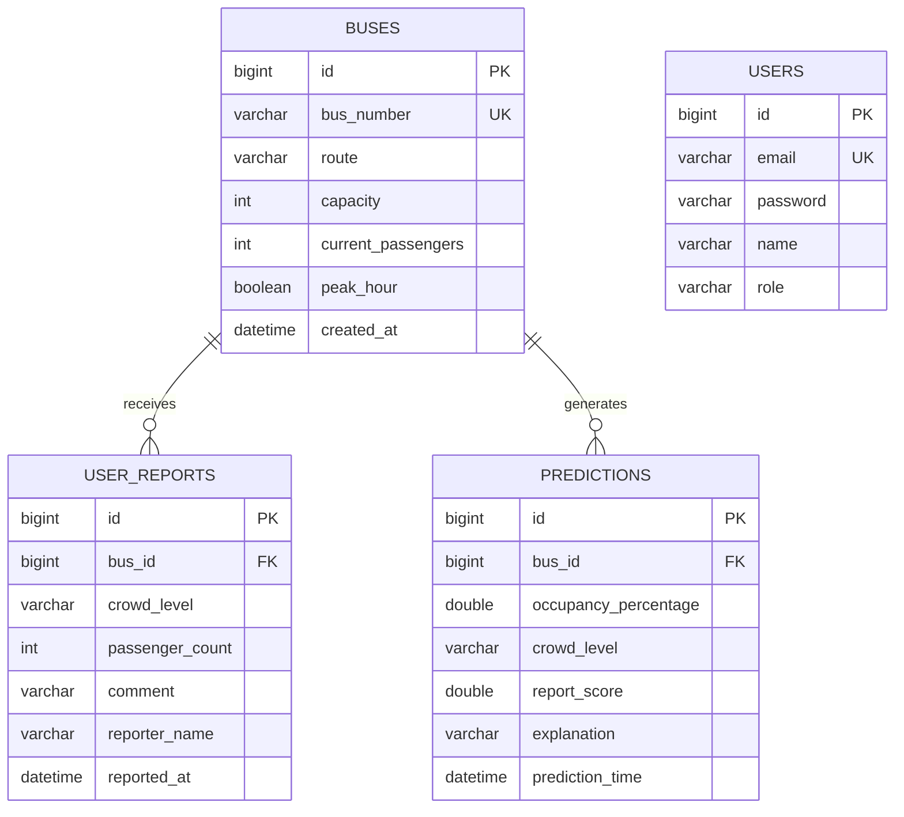
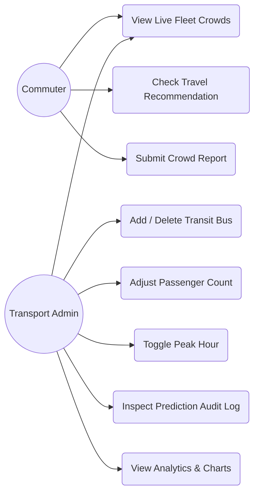
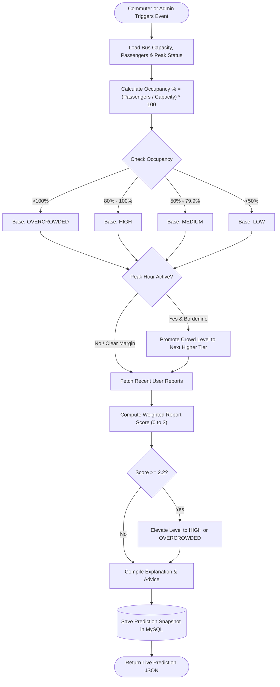
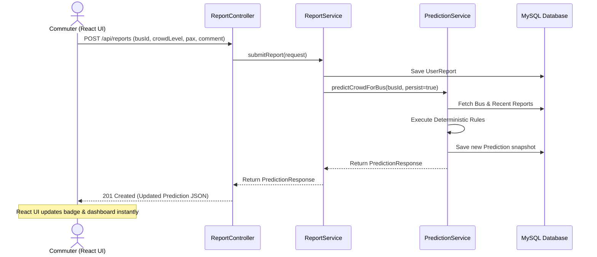
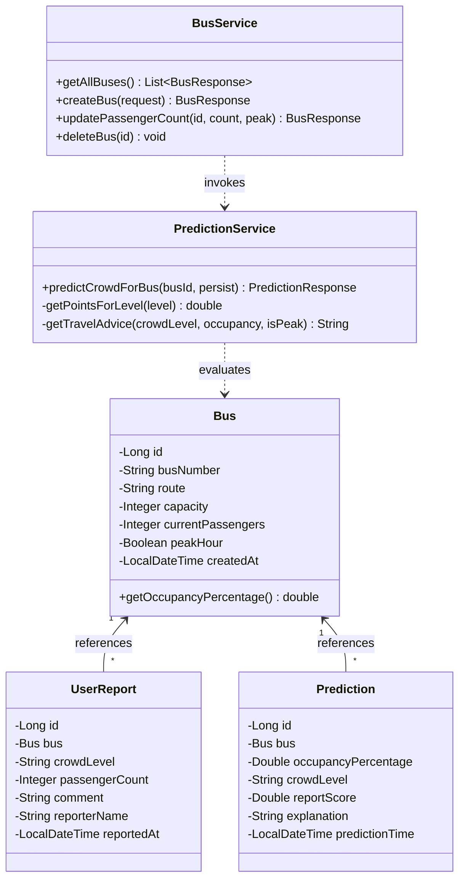

# Public Transport Crowd Predictor — Complete Project Documentation & Report

**Project Title**: Public Transport Crowd Predictor (CrowdTrack)  
**Type**: Full-Stack Web Application  
**Architecture**: React Frontend + Spring Boot Backend + MySQL Database  
**Prediction Approach**: Deterministic Rule-Based Algorithm (Zero AI/ML)  

---

## Table of Contents
1. [Software Requirements Specification (SRS)](#1-software-requirements-specification-srs)
2. [UML & Architectural Diagrams](#2-uml--architectural-diagrams)
   - [2.1 High-Level Architecture](#21-high-level-architecture)
   - [2.2 Entity Relationship (ER) Diagram](#22-entity-relationship-er-diagram)
   - [2.3 Use Case Diagram](#23-use-case-diagram)
   - [2.4 Activity Diagram](#24-activity-diagram)
   - [2.5 Sequence Diagram](#25-sequence-diagram)
   - [2.6 Class Diagram](#26-class-diagram)
3. [Database Design & Data Dictionary](#3-database-design--data-dictionary)
4. [Rule-Based Prediction Engine Specification](#4-rule-based-prediction-engine-specification)
5. [REST API Reference & Test Payloads](#5-rest-api-reference--test-payloads)
6. [Comprehensive Test Case Matrix](#6-comprehensive-test-case-matrix)
7. [Viva & Project Defense Guide (Q&A)](#7-viva--project-defense-guide-qa)
8. [Final Report Chapter Outline (Chapters 1–10)](#8-final-report-chapter-outline-chapters-110)

---

## 1. Software Requirements Specification (SRS)

### 1.1 Purpose
The purpose of the **Public Transport Crowd Predictor** is to deliver real-time, deterministic, explainable crowd-density classifications for municipal public transit buses without relying on machine learning training sets or external AI APIs.

### 1.2 User Classes and Roles
1. **System Administrator / Fleet Operator**:
   - Register new transit buses with route, capacity, and scheduled peak-hour flags.
   - Adjust active onboard passenger counts.
   - Monitor fleet-wide crowd metrics and high-congestion alerts.
2. **Passenger / Commuter**:
   - Inspect live bus crowding levels (🟢 LOW, 🟡 MEDIUM, 🟠 HIGH, 🔴 OVERCROWDED).
   - View actionable travel recommendations.
   - Submit crowdsourced crowd observations, passenger counts, and comments.

### 1.3 Functional Requirements (FR)
- **FR-01 (Authentication)**: Support role-based access for Administrator, Operator, and Commuter accounts.
- **FR-02 (Bus Fleet CRUD)**: Enable creation, retrieval, modification, and deletion of buses.
- **FR-03 (Occupancy Calculation)**: Automatically compute $\text{Occupancy \%} = (\text{Current Passengers} / \text{Capacity}) \times 100$.
- **FR-04 (Rule Classification)**: Map occupancy to 4 discrete categories (LOW, MEDIUM, HIGH, OVERCROWDED).
- **FR-05 (Peak-Hour Modifier)**: Dynamically adjust borderline thresholds when peak hour is active.
- **FR-06 (User Reporting)**: Allow passengers to submit crowd feedback and trigger instantaneous backend recalculation.
- **FR-07 (Audit History)**: Persist all prediction snapshots with timestamps and algorithmic rationale in MySQL.
- **FR-08 (Dashboard & Analytics)**: Present real-time summary statistics, distribution bars, and route rankings.

### 1.4 Non-Functional Requirements (NFR)
- **NFR-01 (Explainability)**: Every prediction must generate an audit trail showing the exact mathematical calculations.
- **NFR-02 (Performance)**: Rule evaluation must execute in $< 5\text{ms}$ on the backend.
- **NFR-03 (Zero Cold Start)**: The system works immediately upon deployment without requiring historical training cycles.
- **NFR-04 (Responsive UI)**: Modern glassmorphism interface responsive across mobile, tablet, and desktop viewports.

---

## 2. UML & Architectural Diagrams

### 2.1 High-Level Architecture


---

### 2.2 Entity Relationship (ER) Diagram


---

### 2.3 Use Case Diagram


---

### 2.4 Activity Diagram (Prediction Workflow)


---

### 2.5 Sequence Diagram (Report Submission & Recalculation)


---

### 2.6 Class Diagram


---

## 3. Database Design & Data Dictionary

### Table: `buses`
| Column Name | Data Type | Constraints | Description |
|:---|:---|:---|:---|
| `id` | `BIGINT` | `PK, AUTO_INCREMENT` | Unique bus entity identifier |
| `bus_number` | `VARCHAR(50)` | `NOT NULL, UNIQUE` | Public fleet number (e.g. "101", "570X") |
| `route` | `VARCHAR(255)` | `NOT NULL` | Transit origin to destination corridor |
| `capacity` | `INT` | `NOT NULL, MIN(1)` | Certified passenger seating/standing capacity |
| `current_passengers` | `INT` | `NOT NULL, DEFAULT 0` | Real-time passenger count onboard |
| `peak_hour` | `BOOLEAN` | `NOT NULL, DEFAULT FALSE` | Flag indicating peak travel rush condition |
| `created_at` | `DATETIME` | `DEFAULT CURRENT_TIMESTAMP` | Fleet registration timestamp |

### Table: `user_reports`
| Column Name | Data Type | Constraints | Description |
|:---|:---|:---|:---|
| `id` | `BIGINT` | `PK, AUTO_INCREMENT` | Unique report identifier |
| `bus_id` | `BIGINT` | `FK -> buses.id, NOT NULL` | Target bus being reported |
| `crowd_level` | `VARCHAR(30)` | `NOT NULL` | Commuter observation: LOW, MEDIUM, HIGH, OVERCROWDED |
| `passenger_count` | `INT` | `NULLABLE` | Commuter's estimate of onboard count |
| `comment` | `VARCHAR(500)` | `NULLABLE` | Situational observation or stop location |
| `reporter_name` | `VARCHAR(100)` | `DEFAULT 'Anonymous'` | Name or alias of reporting passenger |
| `reported_at` | `DATETIME` | `DEFAULT CURRENT_TIMESTAMP` | Report submission timestamp |

### Table: `predictions`
| Column Name | Data Type | Constraints | Description |
|:---|:---|:---|:---|
| `id` | `BIGINT` | `PK, AUTO_INCREMENT` | Prediction history primary key |
| `bus_id` | `BIGINT` | `FK -> buses.id, NOT NULL` | Associated bus |
| `occupancy_percentage` | `DOUBLE` | `NOT NULL` | Computed occupancy metric |
| `crowd_level` | `VARCHAR(30)` | `NOT NULL` | Deterministic classification result |
| `report_score` | `DOUBLE` | `NULLABLE` | Aggregated user community weight (0.0 to 3.0) |
| `explanation` | `VARCHAR(1000)` | `NULLABLE` | Transparent step-by-step mathematical reasoning |
| `prediction_time` | `DATETIME` | `DEFAULT CURRENT_TIMESTAMP` | Timestamp of prediction calculation |

---

## 4. Rule-Based Prediction Engine Specification

The system uses three deterministic mathematical rules:

### Rule 1: Mathematical Occupancy
$$\text{Occupancy \%} = \text{round}\left(\frac{\text{Current Passengers}}{\text{Capacity}} \times 100, 1\right)$$

### Rule 2: Base Threshold Boundaries
- $[0.0\%, 49.9\%] \implies$ 🟢 **LOW**
- $[50.0\%, 79.9\%] \implies$ 🟡 **MEDIUM**
- $[80.0\%, 100.0\%] \implies$ 🟠 **HIGH**
- $> 100.0\% \implies$ 🔴 **OVERCROWDED**

### Rule 3: Peak-Hour Borderline Shift
$$\text{If } \text{peakHour} == \text{true}:$$
- If Base = **LOW** and Occupancy $\ge 40.0\% \implies$ Shift to **MEDIUM**
- If Base = **MEDIUM** and Occupancy $\ge 70.0\% \implies$ Shift to **HIGH**

### Rule 4: Weighted Commuter Feedback
$$\text{Score} = \frac{\sum_{i=1}^{N} \text{Weight}(\text{Report}_i)}{N}$$
Where $\text{Weight}(\text{LOW}) = 0$, $\text{Weight}(\text{MEDIUM}) = 1$, $\text{Weight}(\text{HIGH}) = 2$, $\text{Weight}(\text{OVERCROWDED}) = 3$.
- If $\text{Score} \ge 2.2 \implies$ Elevate to **HIGH** or **OVERCROWDED**.
- If $\text{Score} \le 0.4$ and Occupancy $< 60\% \implies$ Lower to **LOW**.

---

## 5. REST API Reference & Test Payloads

### 1. Get Live Dashboard
- **Endpoint**: `GET /api/dashboard`
- **Response**:
```json
{
  "totalBuses": 6,
  "lowCrowd": 1,
  "mediumCrowd": 2,
  "highCrowd": 2,
  "overcrowded": 1,
  "totalReports": 5,
  "totalPredictions": 7,
  "recentPredictions": [ ... ],
  "topCrowdedBuses": [ ... ]
}
```

### 2. Create Bus
- **Endpoint**: `POST /api/buses`
- **Payload**:
```json
{
  "busNumber": "107",
  "route": "Velachery - CIT",
  "capacity": 60,
  "currentPassengers": 35,
  "peakHour": true
}
```

### 3. Quick Update Passengers
- **Endpoint**: `PATCH /api/buses/1/passengers?count=55&peak=true`

### 4. Submit Commuter Report
- **Endpoint**: `POST /api/reports`
- **Payload**:
```json
{
  "busId": 1,
  "crowdLevel": "HIGH",
  "passengerCount": 54,
  "comment": "Only standing room left after Chromepet",
  "reporterName": "Priya S."
}
```

---

## 6. Comprehensive Test Case Matrix

| Test ID | Module | Scenario / Action | Input Data | Expected Result | Actual Result | Status |
|:---:|:---|:---|:---|:---|:---|:---:|
| **TC-01** | Bus CRUD | Register valid bus | Bus 101, Cap: 60, Pax: 48, Peak: true | HTTP 201 Created; initial prediction stored | Bus created; 80% HIGH generated | **PASS** |
| **TC-02** | Bus CRUD | Duplicate bus number | Bus 101 (already exists) | HTTP 400 Bad Request; error message returned | HTTP 400 "Bus 101 already exists" | **PASS** |
| **TC-03** | Validation | Negative passenger count | Pax: -5, Cap: 60 | HTTP 400 Bad Request; field validation error | HTTP 400 "Current passengers cannot be negative" | **PASS** |
| **TC-04** | Validation | Zero capacity | Cap: 0, Pax: 10 | HTTP 400 Bad Request; field validation error | HTTP 400 "Capacity must be at least 1" | **PASS** |
| **TC-05** | Prediction | Standard base classification | Cap: 60, Pax: 25 (41.7%) | Crowd Level: LOW | Crowd Level: LOW | **PASS** |
| **TC-06** | Prediction | Exceeded capacity | Cap: 50, Pax: 53 (106.0%) | Crowd Level: OVERCROWDED | Crowd Level: OVERCROWDED | **PASS** |
| **TC-07** | Prediction | Peak hour borderline shift | Cap: 60, Pax: 42 (70.0%), Peak: true | Base MEDIUM shifted to HIGH | Shifted to HIGH; peak hour noted in trace | **PASS** |
| **TC-08** | Reports | Submit commuter crowd report | Bus 102, Level: OVERCROWDED, Pax: 65 | HTTP 201; Prediction recalculated to OVERCROWDED | Recalculated to 108.3% OVERCROWDED | **PASS** |
| **TC-09** | History | Retrieve prediction audit log | `GET /api/predictions` | Array of historical records with calculations | Complete audit history returned | **PASS** |
| **TC-10** | Auth | Login with valid credentials | `admin@transport.com` / `admin123` | HTTP 200; token and ADMIN profile returned | Authenticated as ADMIN | **PASS** |

---

## 7. Viva & Project Defense Guide (Q&A)

### Q1: Why did you choose a rule-based algorithm instead of Machine Learning?
**Answer**:
1. **Explainability & Transparency**: Public transport authorities and commuters require clear, auditable reasoning for crowding warnings. ML "black-box" models cannot guarantee why a specific bus was labeled overcrowded.
2. **Zero Cold-Start Requirement**: ML models require thousands of labeled historical rows for each route. A rule-based system operates accurately on Day 1 without training data.
3. **Deterministic Determinism**: The relationship between physical seating capacity (e.g. 60 seats) and passenger volume (48 people) is governed by well-defined mathematical constraints ($48/60 = 80\%$), which is naturally and accurately modeled using business rules.

### Q2: How does the system prevent divide-by-zero errors if capacity is 0?
**Answer**:
In `BusRequest.java`, Jakarta Validation enforces `@Min(value = 1)` on capacity. In `PredictionService.java`, a fallback defensive guard `int capacity = bus.getCapacity() > 0 ? bus.getCapacity() : 1;` ensures mathematical stability under all conditions.

### Q3: How do user reports impact the prediction?
**Answer**:
The backend aggregates the most recent commuter reports for that bus and computes a weighted average score: LOW ($0$), MEDIUM ($1$), HIGH ($2$), OVERCROWDED ($3$). If the average exceeds $2.2 / 3.0$, the rule engine promotes the prediction to warn upcoming passengers, balancing mathematical capacity with real-world commuter observations.

### Q4: What design pattern is utilized in your Spring Boot backend?
**Answer**:
The backend follows the **Layered Architecture Pattern**:
- **Presentation Layer**: `@RestController` handles HTTP requests, DTO conversions, and CORS.
- **Service Layer**: `@Service` contains core business rules, algorithms, and transactional workflows (`@Transactional`).
- **Data Access Layer**: `@Repository` uses Spring Data JPA and Hibernate for database interactions.
- **Domain Layer**: JPA `@Entity` classes representing relational tables.

---

## 8. Final Report Chapter Outline (Chapters 1–10)

- **Chapter 1: Introduction**: Urban transit congestion, commuter pain points, project objectives.
- **Chapter 2: Literature Survey / Existing Systems**: Physical counting gates, ticketing systems, limitations of complex ML datasets.
- **Chapter 3: Proposed System**: Rule-based estimation, hybrid model combining physical capacity with crowdsourced commuter feedback.
- **Chapter 4: System Requirements**: Hardware, OS, Java 21, Spring Boot 3, MySQL 8, Node.js, React 18.
- **Chapter 5: System Design & UML**: Complete architecture, Use Case, Sequence, ER, Activity, Class diagrams.
- **Chapter 6: Implementation Details**: Spring Boot REST controllers, JPA repository queries, React component design, and `PredictionService.java` algorithms.
- **Chapter 7: Software Testing**: Test cases, Postman validation, edge case handling, capacity validation.
- **Chapter 8: Results & Discussion**: Screenshots of Dashboard, Fleet Management, Commuter Reports, Prediction Simulator, and Analytics.
- **Chapter 9: Conclusion**: Achievement of deterministic, explainable crowd prediction.
- **Chapter 10: Future Enhancements**: Automatic GPS telematics integration, turnstile sensor hooks, and mobile app deployment.
